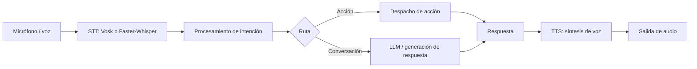

# Ragnart LVA

Ragnart LVA es un asistente virtual de escritorio para Windows que combina interacción por voz, procesamiento de lenguaje, generación de respuestas, síntesis de voz, memoria local y una interfaz gráfica con personaje Live2D. El programa puede ejecutar acciones en el equipo, por lo que el usuario debe revisar las funciones e integraciones que habilita.


## Demo

<!-- Reemplaza la ruta cuando agregues el GIF/video. -->
**GIF/video:** `docs/demo.gif` (pendiente)


## Funciones

- Captura y reconocimiento de voz mediante Vosk o Faster-Whisper.
- Procesamiento de intenciones, selección de acciones y respuesta conversacional.
- Generación de texto mediante los proveedores/modelos implementados en `backend/Generacion/`.
- Síntesis de voz y reproducción de audio.
- Memoria semántica local con almacenamiento e índices propios.
- Integraciones opcionales para aplicaciones, servicios web, WhatsApp, automatización y funciones del sistema.
- Interfaz gráfica configurable, con personaje animado Live2D.

La disponibilidad de cada función depende de sus dependencias, modelos y configuración local.

## Arquitectura

`RAGNART.py` es el lanzador. Por defecto inicia `backend.yatusabe` en un proceso/terminal aparte y abre la interfaz `frontend.Diseno.bonito.main`. También admite modos sin interfaz, solo backend, solo frontend y depuración.

- `backend/yatusabe.py`: coordina el ciclo principal de escucha, reconocimiento, procesamiento, respuesta hablada y acciones.
- `backend/Gestor/`: procesamiento de intenciones, audio, parámetros, memoria y despacho de acciones.
- `backend/Generacion/`: adaptadores de reconocimiento de voz, generación de respuestas y TTS.
- `backend/Datos/`: almacenamiento, taxonomía, análisis semántico e índices de memoria.
- `backend/Funciones/`: acciones e integraciones del sistema, Internet y servicios externos.
- `backend/FuncionesVisuales/`: cámara, gestos, QR y reconocimiento facial.
- `backend/Seguridad/`: utilidades de protección y antivirus del proyecto.
- `frontend/Diseno/bonito/`: interfaz gráfica, control del personaje y recursos Live2D.
- `importaciones/`: recursos de la aplicación, configuración inicial y componentes auxiliares. Los datos de ejecución se generan localmente y no son necesarios para distribuir como datos personales.
- `tests/`: pruebas automatizadas y manuales.



## Requisitos

- Windows 10/11 recomendado; el lanzador comprueba Python 3.10 o superior.
- Python 3.11 recomendado para coincidir con el wheel local de `dlib` disponible en el proyecto.
- Node.js/npm para el bot de WhatsApp y módulos JavaScript.
- Micrófono y salida de audio para las funciones de voz.
- Modelos de voz/IA y recursos Live2D requeridos por las funciones que se quieran utilizar.

Algunas integraciones requieren Internet, cuentas o claves API. Funciones de cámara, control global del escritorio y Live2D dependen de bibliotecas y componentes específicos de Windows.

## Instalación

En PowerShell, desde la carpeta raíz:

```powershell
py -3.11 -m venv .venv
.\.venv\Scripts\Activate.ps1
python -m pip install --upgrade pip
python -m pip install -r requirements.txt
python -m pip install -r frontend/Diseno/bonito/requirements.txt
npm install
Copy-Item .env.example .env
```

Completa en `.env` solo las variables de los servicios que usarás. No compartas ese archivo. Instala o configura aparte los modelos de voz, modelos Live2D y recursos externos que necesite tu instalación. Si una dependencia opcional falla, puedes omitirla si no necesitas la función asociada.

## Ejecución

```powershell
python RAGNART.py
```

Opciones del lanzador:

```powershell
python RAGNART.py --backend-only
python RAGNART.py --frontend-only
python RAGNART.py --nogui
python RAGNART.py --debug
```

`--backend-only` ejecuta la escucha en el proceso actual; `--frontend-only` abre solo la GUI; `--nogui` ejecuta el backend sin interfaz y mantiene el lanzador activo; `--debug` activa logging detallado. Los registros se escriben en `logs/`.

## Configuración y datos locales

Las claves se cargan desde `.env`. Las preferencias del asistente y del personaje se manejan desde los archivos/configuración de `importaciones/` y mediante `backend/configuracion_*.py`. Las bases de datos, memoria, conversaciones, contactos, perfiles faciales, cachés y sesiones pueden contener datos personales; son datos locales de cada instalación y no forman parte del código fuente distribuible.

## Pruebas

Las pruebas están en `tests/`. Algunas pruebas manuales dependen de dispositivos, modelos, servicios o bibliotecas del sistema. Ejecuta las que correspondan a tu entorno.

